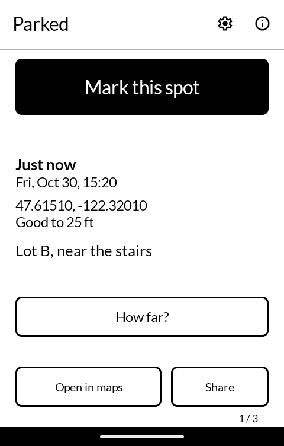
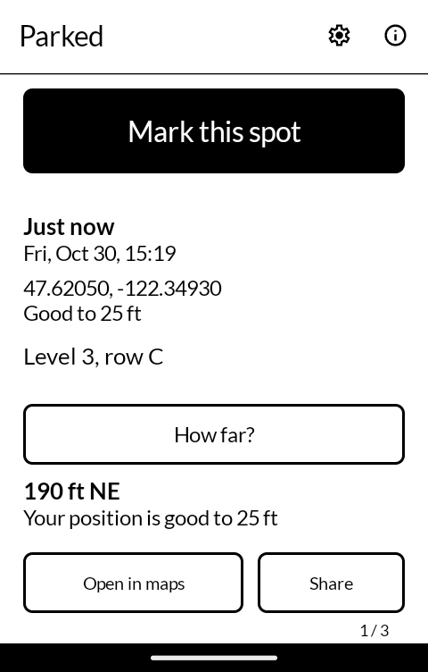
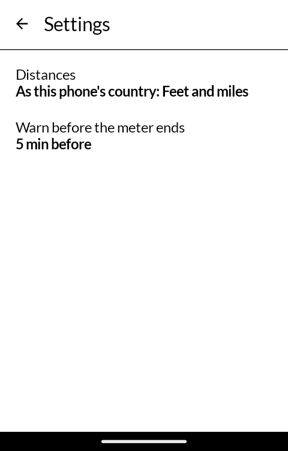
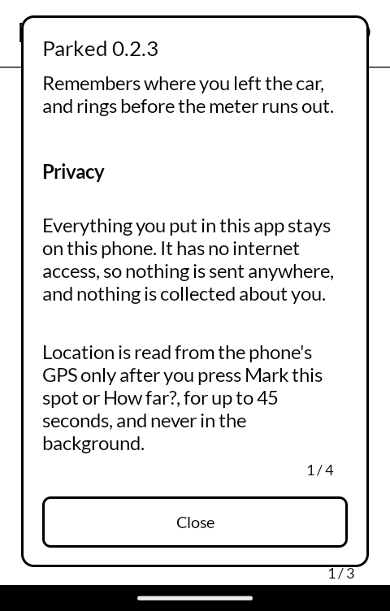

# 置き場 okiba — Parked

Remembers where you left the car, and how long you have. Press one button when you get out and
the phone marks the spot; press another on your way back and it tells you how far it is and which
way. A parking meter built in rings before your time is up. Built for the
[Mudita Kompakt](https://mudita.com/products/kompakt/), and it will install on any Android 12
device.

*Okiba* is 置き場 — the place where a thing is put.

Written from scratch in Kotlin and Jetpack Compose, using Mudita's own
[MMD](https://github.com/mudita/MMD) design system so it looks like the apps the phone already
ships with.

| | | | |
|---|---|---|---|
|  |  |  |  |

## How it works

- **Mark this spot** takes a fresh position from the phone's GPS and keeps it, with how long
  ago and the date and time. The first position a GPS gives is often its roughest, so it waits
  for one good to about 15 m, or 20 seconds after the first, and keeps the best; it always says
  how exact the spot is. A note, such as "level 3, row C", can be added afterwards.
- **How far?** takes another position and says how far away the car is and which way, as a
  distance and a compass point: "180 m NE". If you are within the margin of error it says
  "About here" rather than a number it cannot stand behind, and it always says how sure the
  phone is of where you are standing.
- **Open in maps** hands the spot to whatever maps app is on the phone, as a standard `geo:`
  address, so HERE WeGo, Organic Maps, OsmAnd or any other can take it from there.
- **Share** sends the spot as plain text: a line to read, a `geo:` link and a web map link.
- **Forget this spot** asks once more, in its own face, before it does.
- **Meter**: 30 min, 1 h, 2 h, another length, or the time on the ticket ("Ends at…"). The app
  rings a few minutes before the meter ends (5 by default; Settings changes it or turns it off)
  and again when it ends, with the phone's alarm sound and a buzz, and lights the screen over the
  lock screen. It works alone, with no other app, and sets its alarm again if the phone is
  restarted. On a Kompakt it says once to switch Parked on in DuraSpeed, which would otherwise
  shut it down and its alarm with it.
- The last five spots are kept, newest first; press an earlier one to bring it back to the top.
- Distances are in metres or feet as the phone's country uses them (from its SIM card, or its
  language setting), and Settings can fix them to either.

A garage or a roof hides the sky, and the GPS may not find a position there. The app says so
rather than guessing: mark the spot at the entrance, and put the level in the note.

## What it does not do

It collects nothing and sends nothing. It has **no internet permission**, so it cannot. The
only permission it asks you for is location, and only when you press a button: up to 45 seconds
of the GPS per press, from the GPS alone, with no background location and no service. Where you parked stays in the app's private storage on the phone, is left out of
backups, and goes when the app does. The meter needs alarms, notifications, the ringing screen
over the lock screen and a start after a restart, and uses them for nothing else. See
[PRIVACY.md](PRIVACY.md).

## Building

```
./gradlew assembleRelease
```

A release is signed by a keystore in `signing/`, which is not in this repository. Without it the
release APK builds **unsigned** and will not install anywhere; there is no fallback key by
design.

## Getting it, and keeping it

Download <https://github.com/wanderwildwood/okiba/releases/latest/download/okiba.apk>
and sideload it. That address always points at the newest release, and every release
publishes a `.sha256` beside the APK if you would rather check than trust.

For updates without doing this by hand, add this repository to
[Obtainium](https://github.com/ImranR98/Obtainium):

    https://github.com/wanderwildwood/okiba

## Licence

GPL-3.0-only. See [LICENSE](LICENSE).

Copyright (C) 2026 wander wildwood

This program is free software: you can redistribute it and/or modify it under the terms of the
GNU General Public License as published by the Free Software Foundation, version 3.

This program is distributed in the hope that it will be useful, but WITHOUT ANY WARRANTY;
without even the implied warranty of MERCHANTABILITY or FITNESS FOR A PARTICULAR PURPOSE. See
the GNU General Public License for more details.

You should have received a copy of the GNU General Public License along with this program. If
not, see <https://www.gnu.org/licenses/>.

Icons are from Material Symbols, Apache 2.0.
